# Express Car Wash Simulator — video reference

Source: [Express Car Wash Simulator | Demo — Mr Jolly Roger](https://www.youtube.com/watch?v=nMAUrbUJ5LQ), 33:05, published April 3, 2026. YouTube also labels the game **Express Car Wash Simulator: Prologue**. Research captured October 24, 2026.

## What the reference establishes

The useful interaction reference is a car-centered cleaning view: move a sponge across panels to build local foam, then use a hand-held hose to remove it. Dirt/foam and exposed paint provide immediate visual feedback. The initial car is heavily dirty, and windows, roof, front, rear and sides are reached from different viewpoints. An elevation control exposes the roof. The footage does not establish whether the car rotates in world space versus the camera orbiting; avoid treating that distinction as proven from the video alone.

The open-air bay has blue partitions, a translucent overhead canopy, a grated floor drain, and a red hanging cloth. Customer parking, delivery/finish areas, an office, and separate soap storage sit around the lot. The player also walks and drives between tasks. This is useful spatial reference, not evidence for a miniature studio or robot apparatus.

Progress is deliberately layered: a current foaming percentage, total cleaning percentage, a target marker, and a right-hand task checklist. The first job has a 64% cleaning goal; the finish option is already available at 91%. At the customer handover the interface reports mood, money and a bonus. This supports threshold-based completion, but does **not** prove that work below the target earns a reward or that decorations are awarded. Foam and soap supplies can run out; the sponge needs rewetting. These interruptions are visible/captioned, but need not be copied into Level 1.

## Thief event: present, police call unverified

- **23:20–23:31:** tutorial introduces suspicious customers, a visible odor cue and a baseball bat. A risk meter and accept/kick choices appear.
- **24:13–24:42:** the player buys/equips the bat and confronts the customer; the captured 24:42 frame shows the customer on the ground. This happens before the later non-payment sequence.
- **25:29–25:46:** the car has been cleaned and is returned; commentary identifies the key-handover choice.
- **25:48–26:08:** the payment attempt advances the thief objective. The player looks around the lot; commentary expresses inability to pursue without a vehicle.
- **26:25–26:28:** automatic captions indicate the customer has escaped. No successful capture or police call was verified. The demonstrated event is best described as a suspicious/non-paying customer encounter, not a verified robbery of the premises.

## Application to our Level 1 Exploration study

**Borrow the interaction principle:** work directly on a visible surface; show the tool contact point, localized treatment and remaining untreated areas; let the user understand progress without reading instructions. Keep step progress separate from overall quality. Give completion a clear, rewarding presentation.

**User-specified additions, not observed claims:** rinse → soap → scrub top/sides → pressure-wash tires → rinse → wax → dry; an articulated robot following cursor/finger immediately; mini car-map part selection; 0.25-second turns; three zoom levels; scoring partial work and decorating the entering vehicle. Dedicated tire-pressure cleaning, wax, drying and decoration rewards were not verified in the inspected footage. A hose is visibly used near wheels, which alone does not establish a tire-specific stage.

**Inference/design proposal:** adapt the reference's clear physical cause-and-effect to the robot, and use the mini-map to make hard-to-reach surfaces accessible. If a thief surprise is retained, define its child-appropriate resolution separately; do not claim the reference demonstrates calling police.

## Evidence and limitations

These are browser-captured reference frames, not frame-accurate video exports. Timestamps are observed player times or approximate capture windows; use linked times to review nearby action. A full-video download returned HTTP 403, so browser playback, metadata and automatic captions were used. This is targeted visual sampling plus caption review, not a claim to have watched every second continuously. Automatic captions can contain errors and do not prove the absence of an unspoken mechanic. No reusable game models, textures, sounds or assets were extracted.

The Game Oracle endpoint was located in the repository and queried for “car wash”; its top results were broad unrelated matches, so they were not used as evidence. Raw response is saved as `oracle-search.json`. Shared carwash study files and the active checkout were not changed.

## Timestamped frames

### [03:57 — Arrival and layout](https://www.youtube.com/watch?v=nMAUrbUJ5LQ&t=237s)

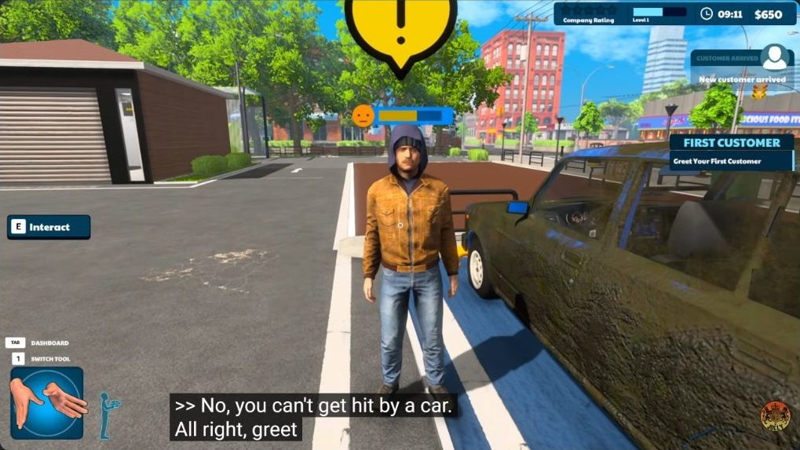

Dirty vehicle and customer in a marked parking area. The wash operates in a sunny outdoor lot, with a small service building and street beyond.

### [05:10 — Sponge / local foam](https://www.youtube.com/watch?v=nMAUrbUJ5LQ&t=310s)

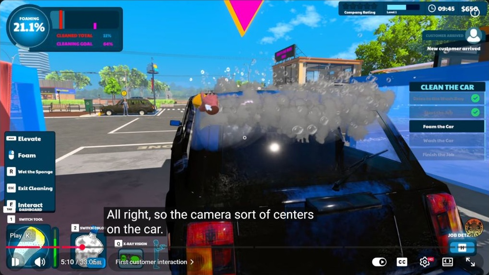

A hand and sponge work directly over the car surface. Bubble clusters cover the rear glass and roof. HUD shows 21.1% foaming, 11% cleaned total, and a 64% cleaning goal.

### [06:36–06:37 — Foam coverage / next step](https://www.youtube.com/watch?v=nMAUrbUJ5LQ&t=396s)

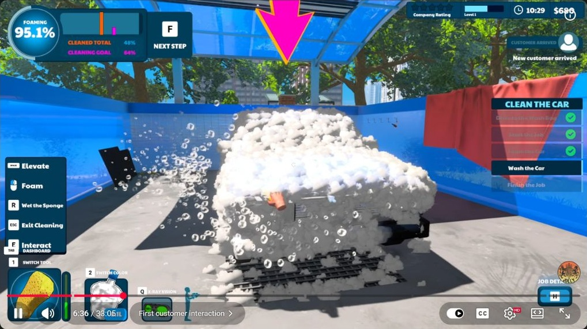

The front is covered in thick foam; the checklist has advanced to washing and offers the next step. This frame is still the sponge tool, not the rinse tool.

### [08:32 — High view of roof](https://www.youtube.com/watch?v=nMAUrbUJ5LQ&t=512s)

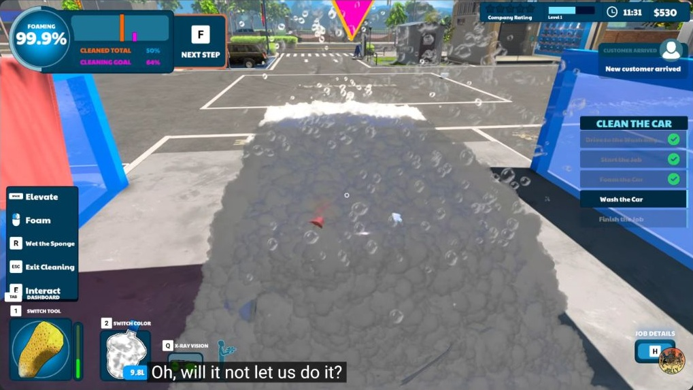

Elevated viewpoint exposes the roof. HUD offers Elevate, wet sponge, switch tool, switch soap color and X-ray vision. Nearly complete foaming corresponds to only 50% cleaned total.

### [09:20 — Hose / local removal](https://www.youtube.com/watch?v=nMAUrbUJ5LQ&t=560s)

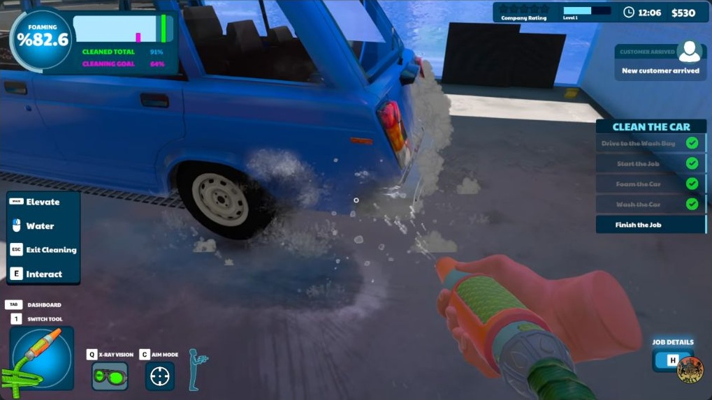

Hand-held hose sprays near the rear wheel and body. Blue paint is exposed while foam remains on adjacent surfaces. Total cleaned is 91%, above the 64% goal, and finishing is available.

### [about 11:02 — Customer feedback](https://www.youtube.com/watch?v=nMAUrbUJ5LQ&t=662s)

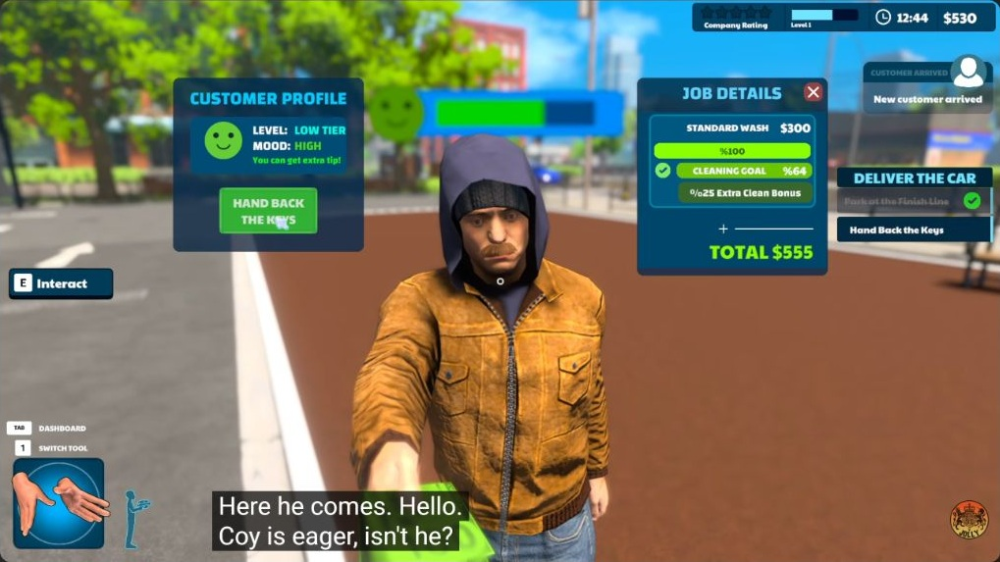

Customer panel displays high mood. Job panel shows standard wash $300, 100% work, 64% goal, extra-clean bonus indicator and total $555. Do not infer the arithmetic from this single frame.

### [about 23:25 — Suspicious-customer tutorial](https://www.youtube.com/watch?v=nMAUrbUJ5LQ&t=1405s)

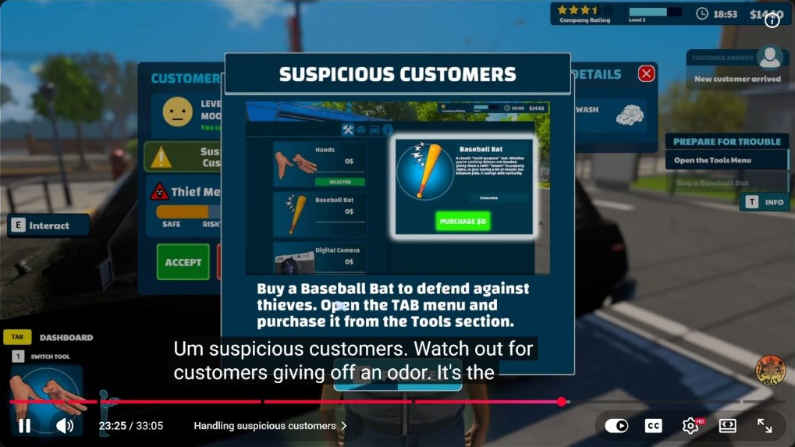

Tutorial directs the player to acquire a baseball bat. Behind it are a suspicious-customer warning and a thief-risk meter.

### [about 23:28–23:30 — Risk and acceptance](https://www.youtube.com/watch?v=nMAUrbUJ5LQ&t=1409s)

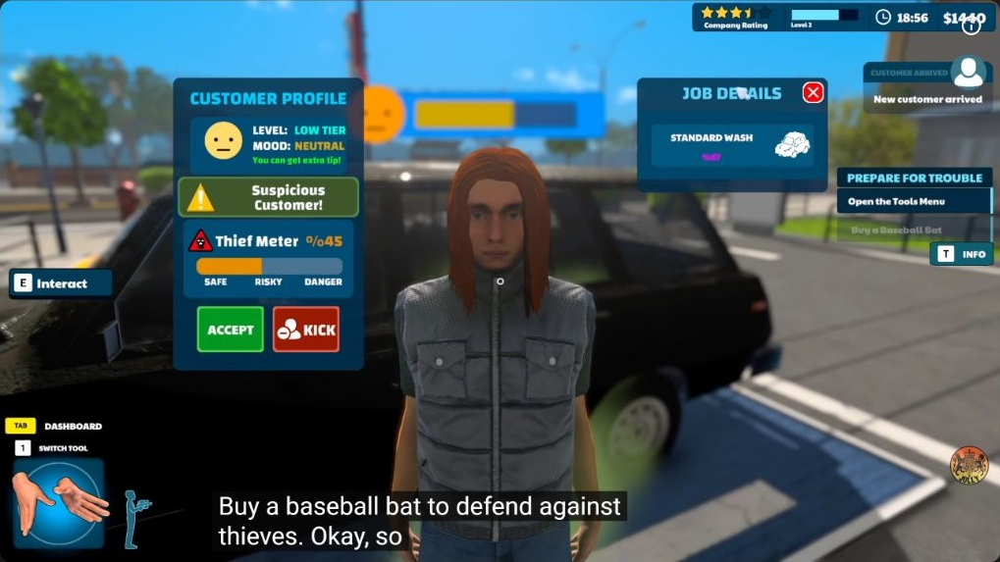

Customer emits a greenish haze. Panel has a thief meter with safe/risky/danger zones and accept/kick choices. This filename was captured after the tutorial closed.

### [24:42 — Bat confrontation](https://www.youtube.com/watch?v=nMAUrbUJ5LQ&t=1482s)

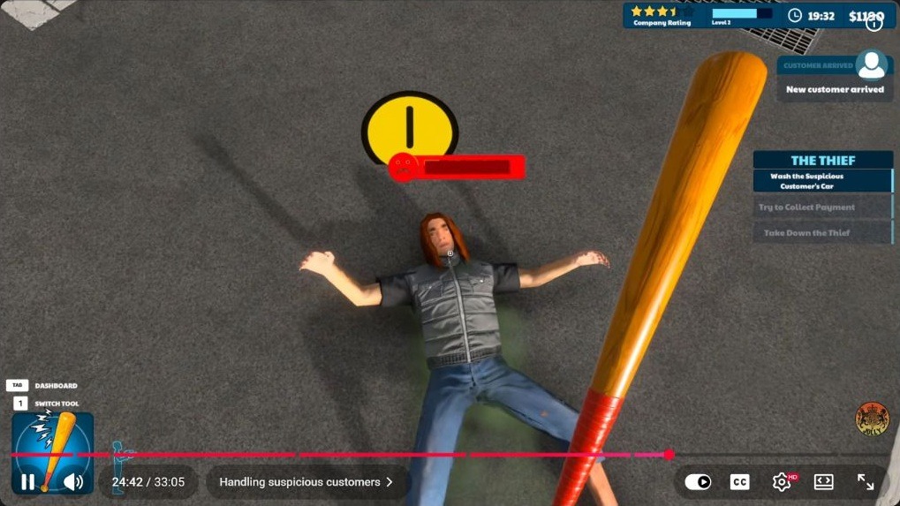

Bat is held in view and the suspicious customer is lying on the ground. The objective still asks for the customer car to be washed; this is before the later payment/escape event.

### [25:48–25:50 — Payment triggers thief objective](https://www.youtube.com/watch?v=nMAUrbUJ5LQ&t=1548s)

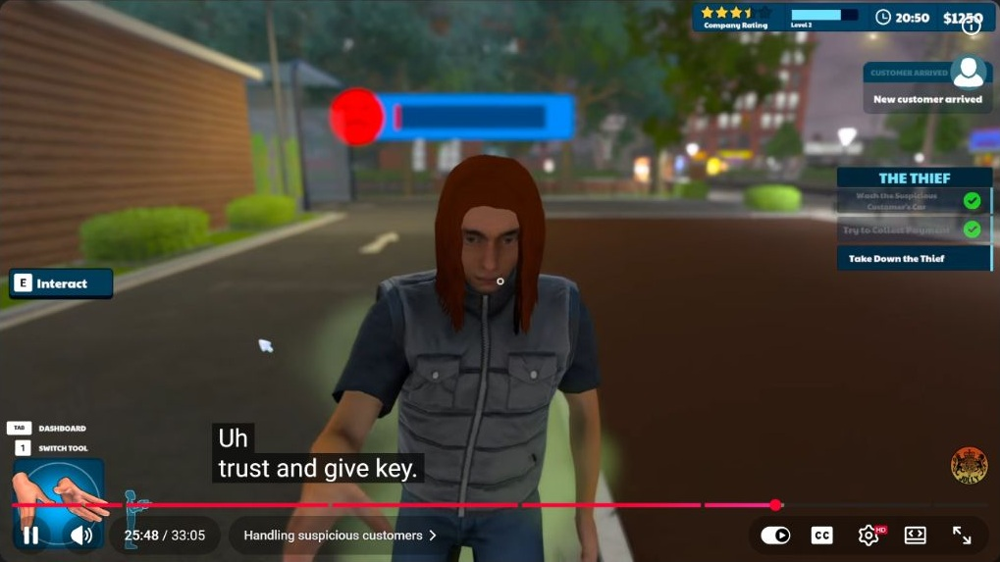

After the key-handover choice, washing and payment-attempt checklist items are checked. The remaining objective is to take down the thief.

### [26:07–26:08 — Unresolved pursuit](https://www.youtube.com/watch?v=nMAUrbUJ5LQ&t=1567s)

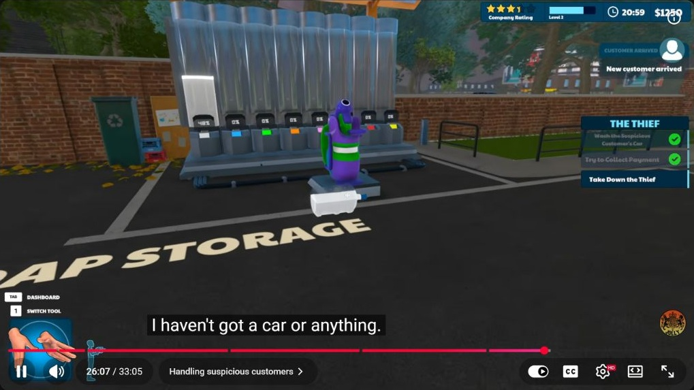

Player looks toward soap-storage equipment with the thief objective active. Captions express that they have no vehicle. This frame establishes the objective, not a successful chase or police call.
